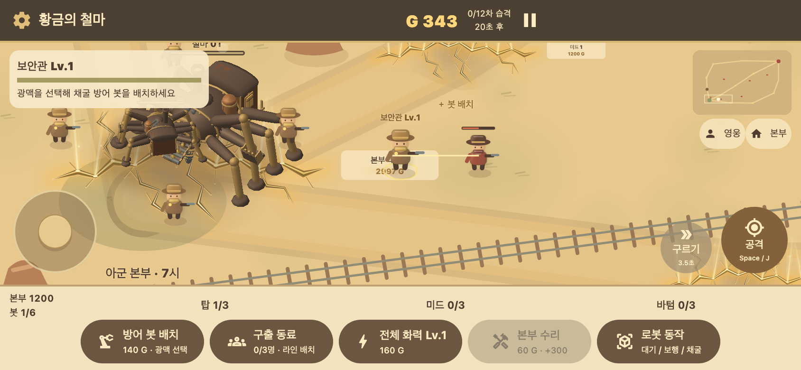

# 황금의 철마 · 3라인 채굴 디펜스

현재 시작 화면은 영웅을 직접 조종하는 서부 스팀펑크 디펜스 프로토타입입니다.



- 아군 본부는 **7시**, 적 진입로는 **1시**이며 탑·미드·바텀으로 연결됩니다.
- 본부 대형 로봇은 자동 채굴합니다. 각 라인의 광맥을 탭하거나 **방어 봇 배치**를 눌러 소형 봇을 보냅니다. 비용 140 G, 최대 6대입니다.
- 소형 봇은 이동 후 채굴·자동 사격을 시작합니다. 금이 고갈되어도 방어하며, 파괴되거나 회수한 자리는 다시 배치할 수 있습니다.
- 영웅은 **왼쪽 스틱으로 이동**, **공격 버튼을 눌러 사격**, **구르기로 빠르게 이동·회피**합니다. 기본 공격은 입력할 때만 가까운 적을 향해 발사합니다.
- PC에서는 **WASD / 방향키 이동**, **Space / J 사격**, **Shift / K 구르기**, **E 구출**을 사용합니다. 빈 지면을 클릭하면 그곳으로 이동합니다.
- 폭탄병은 착탄 지점을 고정 표시하고, 구르는 폭탄은 느리게 이동합니다. 보스는 단계에 따라 폭탄·지면 드릴·구르는 폭탄 패턴을 추가합니다.
- **3·6·9웨이브**에 12개 후보지의 근거리·중거리·원거리 구역에서 캠프가 한 곳씩 생성됩니다. 발견한 위치와 이전 캠프는 유지됩니다.
- 첫 캠프는 보스 1명과 졸개 3명, 다음 캠프들은 보스 1명과 졸개 4명입니다. 경비를 모두 처치하고 가까이서 구출한 뒤 동료를 세 라인에 배치합니다. 라인당 1명이며 교대 배치할 수 있습니다.
- 일반 정글 몬스터를 처치하면 공용 금과 영웅 경험치를 얻습니다. 정글 캠프는 전멸 후 50초 뒤 다시 생성됩니다.
- **12차 습격의 라인 적을 모두 막으면 승리**, 본부 내구도가 0이 되면 패배합니다. 영웅은 쓰러진 뒤 7초 후 본부에서 복귀합니다.

## 실행

```sh
bash scripts/run_game.sh
```

IDE의 **Game (Chrome 8081)** 실행 설정도 같은 시작 화면을 사용합니다. 이전 실행이 켜져 있다면 종료 후 다시 실행하세요. 로컬 브라우저에서는 기존 게임의 서비스 워커·캐시를 정리해 예전 화면이 남는 문제를 방지합니다.

하단 **로봇 동작**에서 실제 3D 모델의 대기·거미 보행·드릴/굴착 애니메이션을 보고 좌우 드래그로 돌려 볼 수 있습니다.

## 모델과 디자인

- `app/assets/models/frontier_robot.glb`: 독립적인 3D 뷰어에서도 열 수 있는 관절 모델과 세 가지 애니메이션.
- `app/assets/models/frontier_robot.scene.json`: 같은 모델을 게임의 Flutter 삼각형 렌더러에서 사용하는 데이터.
- `scripts/build_frontier_robot.py`: 모델·관절·애니메이션 생성 소스. 여덟 다리의 접지 구간과 움직이는 드릴·굴착 팔·버킷·컨베이어를 포함합니다.
- `app/assets/design/`: 원화, 실행 화면, 로봇 애니메이션 미리보기. 원화와 실제 플레이용 모델은 별도입니다. 현재 모델은 동작을 검증하기 위한 절차적 3D 초안이며 원화 수준의 완성 모델은 아닙니다.

월드 크기는 3,600 × 2,400입니다. 특정 상용 게임의 실제 크기를 복제한 수치는 아닙니다.

## 검증

```sh
cd app
flutter analyze lib/frontier lib/main.dart test/frontier_test.dart tool/frontier_checks.dart
flutter test test/frontier_test.dart test/rts_map_test.dart
cd ..
python3 scripts/check_robot_model.py
node scripts/check_pwa.cjs --working-tree
```

테스트 소켓을 열 수 없는 호스트에서는 `app/tool/check_frontier.dart`를 Flutter frontend compiler로 컴파일하고 `flutter_tester --disable-vm-service --non-interactive --run-forever`로 실행합니다. 공통 게임 규칙 검사, 모바일 세 크기의 두 손가락 조작, 3D 프레임 렌더링을 수행합니다.

---

# 광맥 PWA

상위 LandMine Flutter + Flame 게임을 웹으로 옮긴 프로젝트입니다. 원본 앱은 수정하지 않습니다.

- 게임 소스: `app/lib/`
- 웹 설치, 탐지음, 로딩 화면: `app/web/`
- 배포 주소: https://ninano0907.github.io/LandMine_Web/
- `main` 루트에 빌드 결과를 함께 커밋합니다. 기존 Pages의 브랜치 배포를 그대로 사용합니다. GitHub Actions는 소스 검사·테스트·재빌드 결과를 별도로 보관합니다.
- Pages 설정은 **Deploy from a branch → main → / (root)** 입니다.

## 개발과 빌드

Flutter 3.38.9 / Dart 3.10 이상.

```sh
cd app
flutter pub get
flutter run -d chrome
```

저장소 루트에서 `bash scripts/build.sh`로 배포 파일을 만듭니다. `/LandMine_Web/` 경로에 맞춰 빌드하며 렌더러를 포함해 오프라인 자산을 미리 저장합니다. 다른 저장소 이름을 사용하면 스크립트의 base-href를 변경합니다.

## 조작과 설치

탐사인 구매 → 광맥 발견·채굴 → 공장과 갱도를 레일로 연결 → 수레 운반·정련 → 중개인에게 금 판매.

- 터치: 기존 게임과 같은 탭·레일 드래그, 두 손가락 지도 이동·확대.
- PC: 휠 확대·축소, 오른쪽/가운데 버튼 또는 스페이스를 누른 채 드래그로 지도 이동. 미니맵 클릭도 가능합니다.
- Android/PC: 지원 브라우저에서 ‘앱 설치’ 버튼 또는 브라우저 설치 메뉴.
- iPhone/iPad: Safari의 공유 → 홈 화면에 추가. 가로 화면 권장.
- 처음 온라인으로 로딩과 캐시 저장을 마치면 오프라인 실행 가능. 업데이트는 앱을 닫았다 다시 열어 반영합니다.
- 탐지음은 화면을 한 번 누른 뒤 재생됩니다. 진행과 해금은 원본처럼 실행 세션 동안만 유지됩니다.

## 검증

```sh
cd app
dart analyze lib test tool
flutter test
dart tool/check_mining.dart
```

## RTS 브랜치 PWA 테스트

`feature/rts-starcraft-style` 브랜치를 푸시하면 RTS 맵 테스트와 웹 빌드 후
`https://ninano0907.github.io/LandMine_Web/rts/`에 미리보기를 배포합니다.
GitHub Actions의 `Deploy RTS preview` 작업 완료 후 접속하세요.

지원 브라우저의 앱 설치 또는 Safari의 공유 → 홈 화면에 추가로 설치합니다.
첫 온라인 실행에서 오프라인 캐시 저장을 마친 후 오프라인 실행이 가능합니다.
RTS 캐시는 기존 광산 게임과 별도로 관리됩니다. 업데이트 후 앱을 완전히 닫고 다시 열어 주세요.
현재 브랜치의 시작 화면 제목은 ‘황금의 철마’입니다.

## RTS 렌더링 및 애니메이션 개선 TODO

현재 게임은 Flutter `Timer.periodic` + `setState` + `CustomPaint`로 게임 로직과 화면을 갱신하고, 채굴 로봇은 `RobotModel.paint`로 3D 모델을 직접 그립니다. Flame 의존성이 있더라도 메인 화면에서 Flame 게임 루프를 사용하고 있지는 않습니다.

- [ ] **채굴 로봇을 2D 스프라이트 애니메이션으로 전환**: 대기/이동/채굴 동작을 여러 프레임 이미지(스프라이트 시트)로 제작하고 방향별 애니메이션을 표시합니다. 실행 중 3D 모델 직접 렌더링은 교체합니다.
- [ ] 다른 캐릭터, NPC, 봇도 테스트용 Flutter 도형 직접 그리기에서 2D 스프라이트 방식으로 단계적으로 전환합니다. 지형·UI와 캐릭터 표현은 구분해 유지합니다.
- [ ] 게임 로직 갱신과 렌더링을 분리하고 Flame 게임 루프 도입을 검토합니다. 이동 위치는 렌더 프레임 사이에서 보간합니다.
- [ ] 실제 모바일 PWA에서 프레임 시간, 멈춤, 메모리 사용량을 측정해 변경 전후 성능을 비교합니다. 스프라이트 전환만으로 성능 문제가 해결된다고 가정하지 않습니다.

> 이 항목은 **향후 변경 계획**이며, 아직 게임 구현 자체를 수정한 것은 아닙니다.
